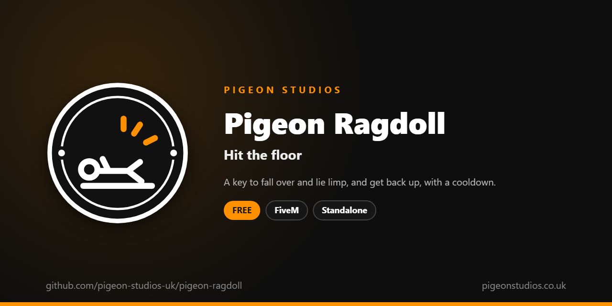

<div align="center">
  

  <h1>Pigeon Ragdoll</h1>

  <p><strong>A key to fall over and lie limp, and get back up, with a cooldown and no falling in vehicles or water.</strong></p>

  <p>
    <a href="https://github.com/pigeon-studios-uk/pigeon-ragdoll/releases/latest"></a>
    <a href="LICENSE.md"></a>
    <a href="https://discord.gg/2NFVWEUmDF"></a>
    
  </p>

  <p>
    <a href="https://github.com/pigeon-studios-uk/pigeon-ragdoll/releases/latest"><strong>Download</strong></a> ·
    <a href="#installation">Install</a> ·
    <a href="#configuration">Configure</a> ·
    <a href="CHANGELOG.md">Changelog</a> ·
    <a href="https://discord.gg/2NFVWEUmDF">Support</a>
  </p>
</div>

---

## Contents

- [Overview](#overview)
- [Features](#features)
- [Requirements](#requirements)
- [Installation](#installation)
- [Updating](#updating)
- [Configuration](#configuration)
- [Localisation](#localisation)
- [Commands and exports](#commands-and-exports)
- [How it works](#how-it-works)
- [Update checker](#update-checker)
- [Performance](#performance)
- [Security](#security)
- [Troubleshooting](#troubleshooting)
- [FAQ](#faq)
- [Support](#support)
- [Contributing](#contributing)
- [Licence](#licence)
- [Credits](#credits)

## Overview

Pigeon Ragdoll is a free resource by [Pigeon Studios](https://pigeonstudios.co.uk) that gives players a key to fall over. Fainting, being knocked down, tripping, playing dead, passing out drunk: roleplay needs a way to hit the floor that isn't an emote frozen in place. With this resource, a player presses U and goes limp, the way GTA's own physics drop a character, and everyone sees it.

Press U again to get up, or set it to get them up after a few seconds. A cooldown stops it being used to dodge bullets, and it can't be used in a vehicle, in water, or while falling or parachuting.

## Features

- **One key.** U by default, which players can change in GTA's key bindings, or `/ragdoll`.
- **Real physics.** The character goes limp with GTA's own ragdoll, which every player sees.
- **Stay down, or not.** Toggle (down until they press again, with a time limit) or timed (up after a few seconds).
- **Cooldown.** A few seconds after getting up before they can fall again.
- **Only where it makes sense.** Not in vehicles, in water, falling, climbing or parachuting.
- **Works with cuffs and carrying.** Other resources can stop it with one export, for example while a player is handcuffed.
- **23 languages.** Follows ox_lib's language, or set your own.
- **Standalone.** No framework or other resources needed.

## Requirements

| Requirement | Version | Notes |
|---|---|---|
| FXServer | A [recommended artifact](https://runtime.fivem.net/artifacts/) | |
| [ox_lib](https://github.com/communityox/ox_lib) | Optional | Used for messages and the language if it's running |

**Frameworks:** none needed. It works the same on standalone and vMenu servers, ESX Legacy, QBCore, Qbox and ox_core.

## Installation

1. **Download** `pigeon-ragdoll.zip` from the [latest release](https://github.com/pigeon-studios-uk/pigeon-ragdoll/releases/latest). Don't use the green **Code** button; release zips are the tested builds.
2. **Extract** it into your server's `resources` folder. The folder must be called `pigeon-ragdoll`.
3. **Start it** by adding this to `server.cfg`, after ox_lib if you use it:

   ```cfg
   ensure pigeon-ragdoll
   ```

4. **Configure** it in `configuration/config.lua` if you want to change anything. The defaults work as they are.
5. **Restart** your server. The console shows one line from the update checker:

   ```text
   [Pigeon Studios] Pigeon Ragdoll v1.0.0 is up to date.
   ```

## Updating

1. Read the [changelog](CHANGELOG.md) for every version between yours and the latest, especially any **Upgrade notes**.
2. Back up your `configuration/` and `locales/` folders.
3. Replace the `pigeon-ragdoll` folder with the new release.
4. Copy your changed settings into the new `configuration/config.lua`. Don't copy the old file over the new one; new versions can add settings.
5. Restart the resource.

## Configuration

All settings are in `configuration/config.lua`, each explained by a comment next to it.

| Setting | Default | What it does |
|---|---|---|
| `Config.Locale` | `'auto'` | The language. `'auto'` follows ox_lib's; or a code such as `'de'` (see [Localisation](#localisation)) |
| `Config.Key` | `'U'` | The default key. Players can change it in GTA's key bindings |
| `Config.Command` | `'ragdoll'` | The command, which the key runs |
| `Config.Mode` | `'toggle'` | `'toggle'`: down until they press again. `'timed'`: down for `Config.Seconds` |
| `Config.Seconds` | `4` | How long they stay down with `'timed'` |
| `Config.MaxSeconds` | `60` | With `'toggle'`, the longest they can stay down. `0` for no limit |
| `Config.CooldownSeconds` | `5` | Seconds after getting up before they can fall again. `0` for none |
| `Config.ShowMessages` | `true` | Tell players why they can't fall over |
| `Config.Notifications` | `'auto'` | `'auto'` (ox_lib if it's running), `'ox_lib'` or `'gta'` |

## Localisation

Pigeon Ragdoll comes in 23 languages: `en` English, `cs` Czech, `da` Danish, `de` German, `es` Spanish, `et` Estonian, `fi` Finnish, `fr` French, `hr` Croatian, `hu` Hungarian, `id` Indonesian, `it` Italian, `nl` Dutch, `no` Norwegian, `pl` Polish, `pt` Portuguese, `pt-br` Brazilian Portuguese, `ro` Romanian, `sl` Slovenian, `sv` Swedish, `tr` Turkish, `zh-cn` Simplified Chinese and `zh-tw` Traditional Chinese. They're the languages ox_lib ships, so your server may already have one set.

With `Config.Locale = 'auto'` (the default), it uses ox_lib's language, so one line in `server.cfg` sets it for this and every other resource that follows ox_lib:

```cfg
setr ox:locale "de"
```

Use `setr`, not `set`, so players' games get it too. Without it, or for a language that isn't in `locales/`, the text is English. To choose a language for this resource only, set `Config.Locale` to its code, such as `'fr'` or `'pt-br'`.

Chinese text can show as blank in GTA's own text, such as its notifications, because GTA only loads its Chinese font when the game itself is set to Chinese. ox_lib's notifications show every language.

Every file was checked for missing text and placeholders, but not every translation has been read by a native speaker yet. If something reads wrong, please send a fix; see [Contributing](#contributing). To add a language, copy `locales/en.lua` to a new file named with the language's code (such as `ja.lua`), change `Locales.en` at the top to match (`Locales.ja`), and translate the text in quotes.

## Commands and exports

### Commands

| Command | Who | What it does |
|---|---|---|
| `/ragdoll` | Everyone | Fall over, or get up again with `'toggle'`. The key runs it |

### Exports

Client exports, for other resources in the player's game:

```lua
-- True while the player is down.
local down = exports['pigeon-ragdoll']:IsDown()

-- Stop the player falling over (true), for example while handcuffed or being carried, or let them
-- again (false). Blocking while they're down gets them up.
exports['pigeon-ragdoll']:SetBlocked(true)
```

## How it works

When the player presses the key, the resource checks they're allowed: not blocked by another resource, not dead, not in or getting into a vehicle, not swimming, falling, climbing or parachuting, and not in the cooldown. Then it puts their character into GTA's limp ragdoll (`SetPedToRagdoll`, type 0) for a second, and renews it every half a second while they stay down.

They get up when they press the key again (`'toggle'`), when `Config.Seconds` or `Config.MaxSeconds` runs out, if they die or end up in a vehicle, or if another resource blocks it. They then get up the way GTA has them get up after any fall, about a second later.

Ragdolls are synced by the game itself, so every player sees the fall. The resource sends nothing of its own.

## Update checker

When it starts, Pigeon Ragdoll checks our public [version registry](https://github.com/pigeon-studios-uk/pigeon-versions) once and prints one line in the server console saying whether it's up to date. If there's an update, it shows what's new and where to get it. The check is a single request to GitHub and sends nothing about your server or players.

Control it for every Pigeon Studios resource at once in `server.cfg`:

```cfg
set pigeon_update_check "on"      # default: one line per resource
set pigeon_update_check "quiet"   # only when there's an update or a problem
set pigeon_update_check "off"     # never check
```

## Performance

Nothing runs while the player is standing, apart from the key binding. While they're down, it renews the ragdoll twice a second. Nothing runs on the server apart from the update check at start-up.

## Security

- It runs only in each player's own game and only changes their own character.
- It has no network events, so there is nothing other players or the server can send it. The exports can only be called by resources in the player's own game.
- The cooldown and the places it can't be used stop it being used to dodge gunfire or escape.
- The only network request is the update check at start-up, from the server to GitHub. It sends nothing about your server or players.

Found a problem? Please don't open a public issue. Use the **Report a vulnerability** button in this repository's **Security** tab, or follow our [Security Policy](https://github.com/pigeon-studios-uk/.github/blob/main/SECURITY.md).

## Troubleshooting

**Nothing happens when I press U.**
Check the key in **Settings → Key Bindings → FiveM → Fall over / get up**; if another resource uses U, change one of them. Try `/ragdoll`; if that shows a message, it says why.

**Players use it to escape handcuffs.**
Have your cuffs resource call `exports['pigeon-ragdoll']:SetBlocked(true)` when it cuffs someone, and `false` when it uncuffs them.

**The text is in the wrong language.**
Check `setr ox:locale` in `server.cfg` (with `setr`, not `set`), or set `Config.Locale` to the language's code.

**The console says "isn't in the version registry" or "couldn't check for updates".**
Your server couldn't reach GitHub, or the check is blocked by a firewall. The resource works normally either way. Turn the check off with `set pigeon_update_check "off"`.

## FAQ

**Is it really free?**
Yes. Use it on as many servers as you like, including ones that take donations. You just can't reupload, resell or bundle it. See [Licence](#licence).

**Does it work on standalone and vMenu servers?**
Yes. It needs no framework at all, and works alongside vMenu.

**Can players be hurt by it?**
No more than GTA's own ragdoll: falling over on flat ground does no damage. Falling over at the top of stairs or a slope is a different matter.

**Does it work with my emote menu?**
Yes. Emotes and ragdolling are separate. Falling over ends whatever emote was playing.

## Support

Read [Troubleshooting](#troubleshooting) first, then ask in the support channels of our [Discord](https://discord.gg/2NFVWEUmDF). Please include your Pigeon Ragdoll version, FXServer artifact and any errors from the console (F8 in game). See [Getting help](https://github.com/pigeon-studios-uk/.github/blob/main/SUPPORT.md).

Found a bug? Open a [bug report](https://github.com/pigeon-studios-uk/pigeon-ragdoll/issues/new/choose).

## Contributing

Fixes, improvements and translations are welcome. Please read the [contributing guide](https://github.com/pigeon-studios-uk/.github/blob/main/CONTRIBUTING.md) first, and open a feature request before working on anything big.

## Licence

Pigeon Ragdoll is free to use under the **[Pigeon Studios Free Licence](LICENSE.md)**.

- ✅ Use it on any number of servers, including monetised ones
- ✅ Change it for your own servers
- ✅ Show it in videos and streams
- ❌ Don't reupload, share or mirror the files; link to this repository instead
- ❌ Don't sell it, bundle it in packs, or put it behind escrow
- ❌ Don't remove the credits

This summary isn't the licence; [LICENSE.md](LICENSE.md) is. Third-party components are listed in [NOTICE.md](NOTICE.md).

## Credits

Made by [Pigeon Studios](https://pigeonstudios.co.uk). Thanks to everyone who has contributed fixes and translations; see the [changelog](CHANGELOG.md).

<sub>Not affiliated with or endorsed by Rockstar Games, Take-Two Interactive or Cfx.re.</sub>
